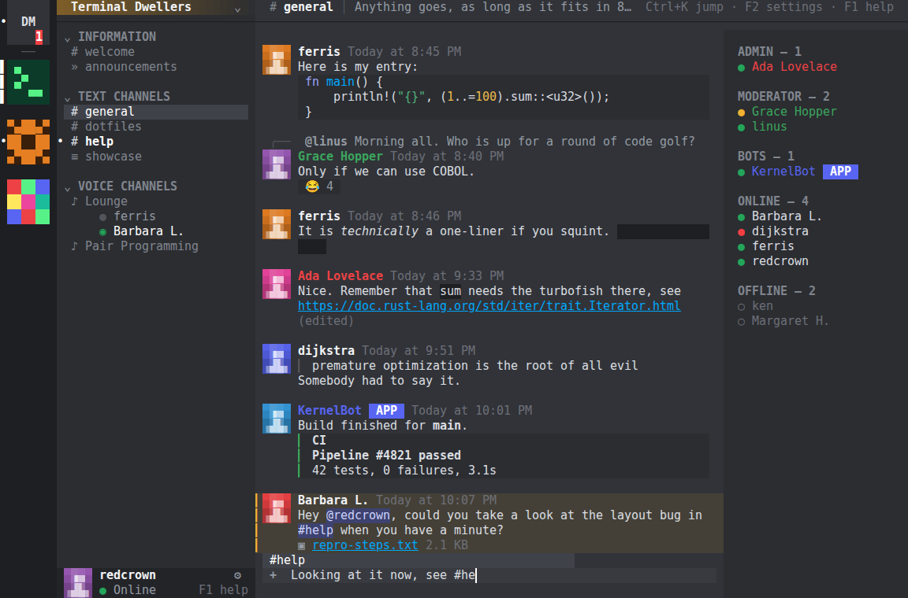
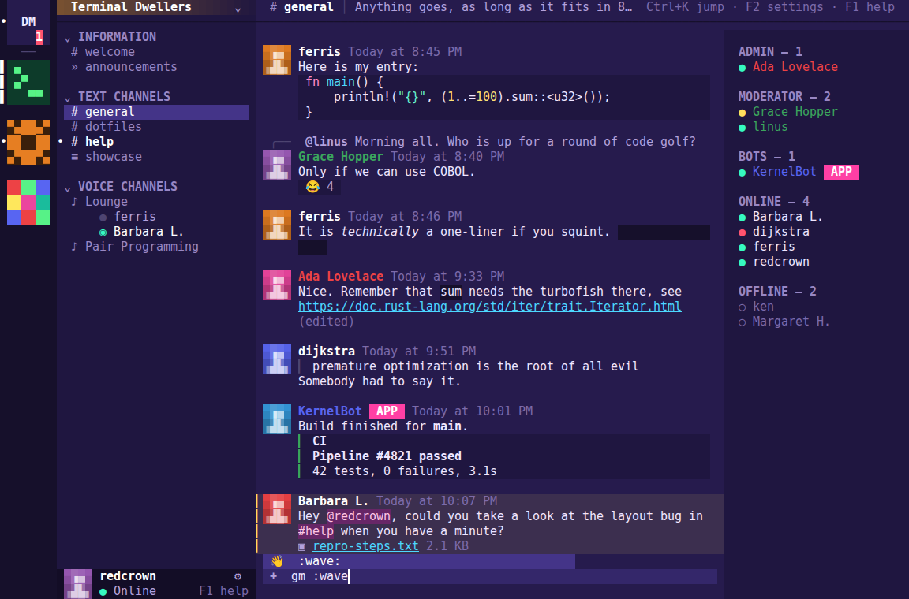
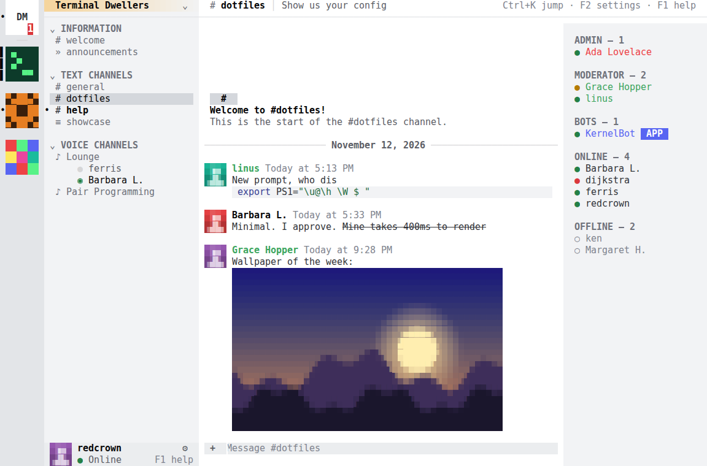

# termcord

Discord in your terminal. The whole four-pane interface (server rail, channel list, chat, member list) drawn with
truecolor ANSI, in plain Node. Text chat and images need **no dependencies**; only voice audio installs packages.



| Synthwave | Light |
| --- | --- |
|  |  |

## Run it

Requires Node 22.12 or newer. Nothing to install for text chat and images.

```sh
node src/index.js --demo      # offline sample servers with simulated activity
```

To connect to real servers, create a bot application and pass its token:

```sh
DISCORD_TOKEN=your-bot-token node src/index.js
```

1. Create an application at <https://discord.com/developers/applications> and add a bot.
2. Under **Bot → Privileged Gateway Intents**, enable **Message Content**, **Server Members** and **Presence**.
   termcord still works without them, but message text, the member list and online status are then limited.
3. Invite the bot to your server with the `bot` scope and the View Channels, Send Messages, Read Message History,
   Add Reactions, Connect and Speak permissions (permissions number `3214400`).

termcord signs in as a **bot account** through Discord's official API. It deliberately does not accept personal
account tokens: automating a user account is against Discord's Terms of Service and gets accounts banned.

## What is in the interface

- Server rail with the active pill, unread dots and mention badges, plus a Direct Messages home
- Channel list with collapsible categories, text / announcement / voice channels, people connected to voice, and
  the user panel
- Chat with avatars, grouped messages, day and NEW dividers, replies, edits, reactions, embeds, attachments,
  mention highlighting and system messages
- Discord markdown: bold, italic, underline, strikethrough, inline code, code blocks, quotes, lists, headings,
  spoilers (revealed when the message is selected), links, user / role / channel mentions
- Eight colour themes (Discord Dark, Midnight, Light, Dracula, Nord, Catppuccin Mocha, Synthwave, Gruvbox)
- Syntax-highlighted code blocks, with comments, strings, numbers, keywords and calls picked out
- Small animations: a startup logo, typing dots, spinners, a glow on new messages, a shimmer on loading pictures
- A pop-up card (and optional terminal bell) when you are mentioned in another channel
- Real user avatars and server icons, in the chat, the server rail, the user panel and profile popups
- Inline image previews for attachments and embeds, drawn with half-block characters, plus a full-size viewer
- Voice channels: join, see who is talking, mute, deafen and disconnect from a "Voice Connected" panel
- Member list grouped by hoisted role and presence, with profile popups
- Composer with multi-line input, drafts per channel, `@` / `#` / `:emoji:` autocomplete and typing indicators
- Quick switcher, infinite scroll through history, mouse support, and a layout that adapts to the window size

## Images

Pictures are drawn with quadrant block characters, which gives two colours and a 2x2 grid of points per cell.
They appear inline in the chat. Select a message (`↑` from an empty composer) and press `v` to open its images
at full window size; `←` / `→` step through several. termcord asks Discord's media proxy for a small PNG of each
picture, so any format Discord can convert is shown and nothing extra needs installing. Animated images and videos
show as a still frame or a file link.

## Voice

Press `Enter` (or click) on a voice channel to join it. To actually hear people and talk you need two extras:

```sh
npm install        # voice protocol, Opus and Discord's end-to-end encryption
```

and [FFmpeg](https://ffmpeg.org/download.html) on your `PATH` (`ffplay` plays what others say, `ffmpeg` records
your microphone). Without them you still join the channel and see who is in it, just without audio.

You join muted. `Alt+M` toggles your microphone, `Alt+D` deafens, `Alt+X` disconnects. Choose the microphone and
the volumes in Settings (`F2`). The bot needs the Connect and Speak permissions in that channel. There is no
push-to-talk or noise suppression: while unmuted, the mic is always live.

## Settings

Press `F2` or click the gear next to your name. Changes apply immediately and are saved to
`~/.config/termcord/settings.json` (`%APPDATA%\termcord\settings.json` on Windows).

| Setting | What it does |
| --- | --- |
| Microphone | Input device for voice. Devices are detected with `pactl` or FFmpeg on Linux and with FFmpeg on macOS and Windows. "System default" follows the OS (on Windows, the first device found). |
| Microphone volume | 0 to 200 %, how loud you are for others |
| Speaker volume | 0 to 200 %, how loud others are for you |
| Join voice channels muted | On by default |
| Inline image previews | Off shows pictures as file links |
| Avatars and server icons | Off shows coloured initials |
| Member list | Same as `Ctrl+U` |
| Theme | One of the eight colour schemes; it changes live as you flip through them |
| Animations | Off removes the startup logo and all motion |
| Mention pop-ups | The card shown when you are mentioned in another channel |
| Mention sound | Rings the terminal bell on mentions and direct messages (off by default) |

The speaker device itself is not selectable; sound plays through the system default output.

## Keys

| Key | Action |
| --- | --- |
| `Tab` / `Shift+Tab` | Cycle focus between servers, channels, messages, composer and members |
| `Ctrl+K` | Quick switcher |
| `Alt+↑` / `Alt+↓` | Previous / next channel |
| `Ctrl+Alt+↑` / `Ctrl+Alt+↓` | Previous / next server |
| `Ctrl+U` | Toggle the member list |
| `Enter` / `Alt+Enter` | Send / new line |
| `↑` in an empty composer | Select messages, then `r` reply, `e` edit, `d` delete, `+` react, `v` view images |
| `Enter` on a voice channel | Join it |
| `Alt+M` / `Alt+D` / `Alt+X` | In voice: mute, deafen, disconnect |
| `PgUp` / `PgDn` | Scroll history |
| `Esc` | Cancel reply or edit, close popups, jump to present |
| `F1` | Shortcut help |
| `F2` | Settings |
| `Ctrl+C` / `Ctrl+Q` | Quit |

Clicking servers, channels, messages and members works too, and the wheel scrolls the pane under the pointer.

## Not supported yet

Video and screen sharing, threads and forum posts, file uploads, slash commands, and server settings. Read state is tracked locally because bots have no
server-side read markers.

## Development

```sh
npm test                                   # node --test, no install needed
node src/index.js --snapshot 120x36        # print one frame as plain text
node src/index.js --demo --theme synthwave # try a theme without saving it
```

`src/screen.js` is the cell buffer and ANSI writer, `src/view.js` draws the panes, `src/app.js` holds UI state and
input handling, and `src/backends/` contains the Discord gateway/REST client and the offline demo. `src/png.js` and
`src/images.js` decode and scale pictures; `src/voice.js` wraps `@discordjs/voice` and the FFmpeg processes; `src/settings.js` loads and saves preferences; `src/theme.js` holds the palettes and `src/highlight.js` the code
highlighter.
